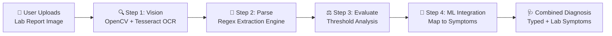

# Lab Report OCR Integration for Medical Chatbot

Upgrade the chatbot from text-only to a system that can read physical medical documents (blood test reports), extract numerical data via OCR, evaluate abnormalities against medical thresholds, and feed lab-derived symptoms into the existing Scikit-Learn ML model for more accurate diagnoses.

## User Review Required

> [!IMPORTANT]
> **Tesseract OCR must be installed separately on your system.** It is a C++ program, not a pure Python library. You'll need to download and install it from [UB-Mannheim/tesseract](https://github.com/UB-Mannheim/tesseract/wiki). The Python packages (`pytesseract`, `opencv-python`) are just wrappers. I'll add instructions for this.

> [!WARNING]
> **This feature supplements (does NOT replace) your existing symptom-entry flow.** Users can still type symptoms manually. The lab upload is an additional, optional input channel. Both sources are merged before the ML model makes its prediction.

---

## Architecture Overview

---

## Proposed Changes

### Backend — OCR Processing Pipeline

#### [NEW] [lab_analyzer.py](file:///d:/MedicalChatbot/lab_analyzer.py)

The core new module containing the entire 4-step pipeline:

**Step 1 — `extract_text_from_image(image_path)`**: Uses OpenCV to preprocess the image (grayscale, adaptive thresholding, denoising) and Tesseract OCR to extract raw text.

**Step 2 — `parse_lab_values(raw_text)`**: A regex engine that hunts for common CBC (Complete Blood Count) markers and returns structured data:

| Marker | Regex Pattern Target | Unit |
|---|---|---|
| Hemoglobin (Hb) | `hemoglobin`, `hb`, `hgb` | g/dL |
| WBC Count | `wbc`, `white blood cell`, `leucocyte` | cells/µL |
| RBC Count | `rbc`, `red blood cell`, `erythrocyte` | million/µL |
| Platelet Count | `platelet`, `plt` | cells/µL |
| Blood Glucose (Fasting) | `glucose`, `fbs`, `fasting blood sugar` | mg/dL |
| Cholesterol (Total) | `cholesterol`, `total cholesterol` | mg/dL |
| Creatinine | `creatinine` | mg/dL |
| Bilirubin (Total) | `bilirubin` | mg/dL |
| ALT/SGPT | `alt`, `sgpt` | U/L |
| AST/SGOT | `ast`, `sgot` | U/L |
| TSH | `tsh`, `thyroid stimulating` | mIU/L |
| Uric Acid | `uric acid` | mg/dL |

**Step 3 — `evaluate_lab_values(parsed_values)`**: Checks each extracted number against standard medical reference ranges and flags `"High"`, `"Low"`, or `"Normal"`.

**Step 4 — `map_to_symptoms(evaluations)`**: Translates abnormal findings into symptoms that exist in the ML model's vocabulary:

| Lab Finding | Mapped Symptom(s) |
|---|---|
| Low Hemoglobin | `fatigue`, `weakness_in_limbs`, `breathlessness` |
| High WBC | `high_fever`, `chills` |
| Low Platelet | `bruising`, `blood_in_sputum` |
| High Glucose | `excessive_hunger`, `polyuria`, `weight_loss`, `irregular_sugar_level` |
| High Cholesterol | `obesity`, `chest_pain` |
| High Creatinine | `swelling_joints`, `dark_urine`, `fluid_overload` |
| High Bilirubin | `yellowish_skin`, `yellowing_of_eyes`, `dark_urine`, `yellow_urine` |
| High ALT/SGPT | `abdominal_pain`, `yellowish_skin`, `loss_of_appetite` |
| High AST/SGOT | `abdominal_pain`, `yellowish_skin`, `nausea` |
| High TSH | `weight_gain`, `fatigue`, `cold_hands_and_feets`, `lethargy` |
| Low TSH | `weight_loss`, `fast_heart_rate`, `sweating`, `anxiety` |
| High Uric Acid | `joint_pain`, `knee_pain`, `swelling_joints` |

> [!NOTE]
> All mapped symptoms are chosen **exclusively** from the existing `list_of_symptoms.pickle` vocabulary so they integrate seamlessly with the Scikit-Learn model.

---

#### [MODIFY] [app.py](file:///d:/MedicalChatbot/app.py)

Changes:
1. Add a new route `POST /upload-lab-report` that accepts an image file upload
2. Call the `lab_analyzer` pipeline on the uploaded image
3. Add the lab-derived symptoms to the existing `user_symptoms` set (merging with typed ones)
4. Return a structured JSON response showing extracted values, evaluations, and mapped symptoms — displayed as a rich formatted message in the chat

---

### Frontend — Upload UI

#### [MODIFY] [index.html](file:///d:/MedicalChatbot/templates/index.html)

Changes:
1. Add a hidden `<input type="file" accept="image/*">` element
2. Add an upload button (📎 icon) next to the restart button in the footer
3. Add a modal/overlay for displaying OCR processing status and results

#### [MODIFY] [main.js](file:///d:/MedicalChatbot/static/js/main.js)

Changes:
1. Add click handler for the upload button that triggers file input
2. Add `handleLabUpload()` function that sends the image via `FormData` to `/upload-lab-report`
3. Display a "scanning" animation while processing
4. Render the lab results as a formatted bot message with a table of values and flags
5. After lab results are shown, user can continue adding typed symptoms or type "Done"

#### [MODIFY] [style.css](file:///d:/MedicalChatbot/static/css/style.css)

Changes:
1. Style the upload button consistently with the existing glassmorphism theme
2. Add styles for the lab results card (table with color-coded High/Low/Normal flags)
3. Add a scanning/processing animation overlay
4. Lab results displayed in a premium card within the chat

---

### Dependencies

#### [MODIFY] requirements.txt (or pip install)

New packages to install into the venv:
- `opencv-python` — Image preprocessing
- `pytesseract` — Python wrapper for Tesseract OCR
- `Pillow` — Image handling (likely already installed)

External system dependency:
- **Tesseract OCR binary** — must be installed on the system

---

## Open Questions

> [!IMPORTANT]
> **1. Do you already have Tesseract OCR installed on your Windows machine?** If not, I'll include step-by-step installation instructions. 

> [!IMPORTANT]
> **2. Are you okay with the lab marker list above (12 markers)?** I chose the most common CBC/metabolic panel markers. I can add or remove markers if you want to focus on specific tests.

> [!NOTE]
> **3. The lab-to-symptom mapping is based on medical literature but is deliberately conservative.** It only maps to symptoms your model already knows. Want me to be more aggressive (map more symptoms per finding) or keep it conservative?

---

## Verification Plan

### Automated Tests
1. **Unit tests for the regex parser** — Feed known lab report text strings and verify correct extraction of marker values
2. **Unit tests for the evaluator** — Verify threshold logic flags correctly
3. **Unit tests for the symptom mapper** — Verify correct symptom sets are produced
4. **Integration test** — Upload a sample lab report image and verify the full pipeline end-to-end

### Manual Verification
1. Run the Flask server and test uploading a real/sample lab report image
2. Verify the chat displays extracted values with correct color-coded flags
3. Type additional symptoms, then type "Done" — verify the diagnosis incorporates both lab-derived and typed symptoms
4. Record a browser demo of the full flow
